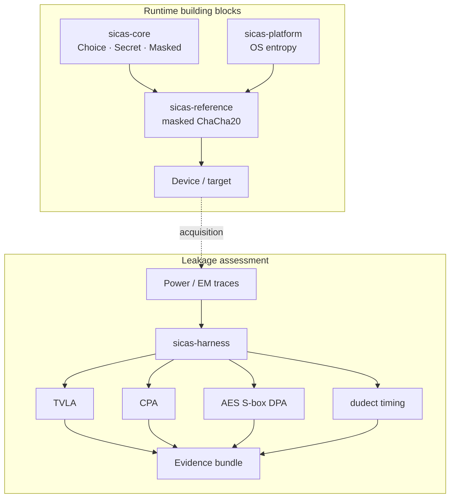

# SiCaS

**Safe, zero-dependency Rust for side-channel attenuation and leakage assessment.**

[](#status)
[](#status)
[](#design-principles)
[](#crate-matrix)
[](rust-toolchain.toml)
[](#license)

> **Pre-release security software.** SiCaS is **not independently audited**, **not
> hardware-validated**, and **not production-ready**. The current public label is
> **SAL-2 locally**. Do not use it to protect real secrets. The production target is
> SAL-4, which requires external audit, independent red team, real hardware
> TVLA/CPA/DPA, and a production signing identity. See [Status](#status) and
> [`docs/GAP_REPORT.md`](docs/GAP_REPORT.md).

## What is SiCaS?

SiCaS is a safe-Rust, zero-runtime-dependency workspace that combines first-order
Boolean-masked primitives and a masked ChaCha20 reference implementation with a
leakage-assessment harness for TVLA, CPA, DPA, and timing analysis. It is a locally
proven, audit-ready engineering package at SAL-2, not a certified or production-ready
cryptographic product.

> **In plain terms:** SiCaS helps engineers build and test software that is harder to
> attack by measuring the unintended power and electromagnetic signals a chip gives off
> while it runs, so weaknesses can be found before deployment.

---

## Table of contents

- [What is SiCaS?](#what-is-sicas)
- [Overview](#overview)
- [Status](#status)
- [At a glance](#at-a-glance)
- [Why SiCaS](#why-sicas)
- [Design principles](#design-principles)
- [Architecture](#architecture)
- [Crate matrix](#crate-matrix)
- [Quick start](#quick-start)
- [Usage](#usage)
  - [Core primitives](#core-primitives)
  - [Masked ChaCha20 reference](#masked-chacha20-reference)
  - [Leakage-assessment workflow](#leakage-assessment-workflow)
  - [Trace format](#trace-format)
  - [Harness commands](#harness-commands)
- [Security model](#security-model)
  - [Threat model](#threat-model)
  - [Claims](#claims)
  - [Non-goals and non-claims](#non-goals-and-non-claims)
- [Performance](#performance)
- [Verification and evidence](#verification-and-evidence)
- [Reproducibility and release](#reproducibility-and-release)
- [Platform support](#platform-support)
- [Repository layout](#repository-layout)
- [Papers](#papers)
- [Documentation](#documentation)
- [Toolchain](#toolchain)
- [Contributing](#contributing)
- [Security disclosure](#security-disclosure)
- [License](#license)

---

## Overview

SiCaS is a local-first engineering project for two closely related problems:

1. **Attenuation** — building first-order Boolean-masked primitives and a masked
   reference integration in safe Rust.
2. **Assessment** — measuring leakage with a zero-dependency harness that implements
   TVLA, CPA, DPA, dudect-style timing checks, preprocessing, and synthetic validation.

The project deliberately keeps implementation and evaluation in one workspace so that
a masking claim and the evidence for that claim live together. Every security claim is
mapped to a proof obligation, a test, a measurement, or a documented limitation.

The current release is a **validation target and evidence toolkit**, not a certified
cryptographic product. The masked ChaCha20 implementation exists to exercise the
masking gadgets and the leakage-analysis path; it is not an audited production cipher.

---

## Status

| Area | State | Evidence |
|---|---|---|
| Full local proof | **PASS** at `8c41e4b` | [`evidence/local-proof-2026-10-31-final-audit/SUMMARY.md`](evidence/local-proof-2026-10-31-final-audit/SUMMARY.md) |
| AES S-box DPA quick proof | **PASS** at `ef13675` | [`evidence/local-proof-2026-10-31-sbox-dpa/SUMMARY.md`](evidence/local-proof-2026-10-31-sbox-dpa/SUMMARY.md) |
| Workspace mutation | **630 mutants, 574 caught, 0 missed, 56 unviable** | [`evidence/mutation/2026-10-31-workspace.md`](evidence/mutation/2026-10-31-workspace.md) |
| Line coverage | **97.28%** | [`evidence/coverage/2026-10-31-dpa.md`](evidence/coverage/2026-10-31-dpa.md) |
| Release artifact | **386,232 bytes**, SHA-256 `1f0d304c…e7da` | [`evidence/release/2026-10-31-sbox-dpa/README.md`](evidence/release/2026-10-31-sbox-dpa/README.md) |
| Evidence bundle | **109 files**, hashes verified | [`evidence/bundle/INDEX.md`](evidence/bundle/INDEX.md) |
| Independent external audit | **PENDING** | [`AUDIT_REQUEST.md`](AUDIT_REQUEST.md) |
| Independent red team | **PENDING** | [`docs/RED_TEAM.md`](docs/RED_TEAM.md) |
| Hardware TVLA/CPA/DPA | **PENDING** | [`docs/HARDWARE.md`](docs/HARDWARE.md) |
| ARM/RISC-V runtime timing | **PENDING** | [`docs/GAP_REPORT.md`](docs/GAP_REPORT.md) |
| Production signing identity | **PENDING** | [`docs/RELEASE.md`](docs/RELEASE.md) |
| Audited zeroization adapter | **PENDING** | [`docs/ZEROIZATION.md`](docs/ZEROIZATION.md) |
| SAL-4 | **NOT CLAIMED** | [`docs/ASSURANCE.md`](docs/ASSURANCE.md) |

**Current public label:** `SAL-2 locally` — hardened locally with tests, Miri,
sanitizers, fuzzing, Kani, mutation testing, coverage, assembly checks, and a
reproducible evidence bundle. It is not `SAL-3` and not `SAL-4`.

The full proof was run at `8c41e4b`. The AES S-box DPA and zeroization additions were
verified at `ef13675` by a quick proof, targeted Miri, workspace mutation, coverage,
AArch64/i686 tests, and release checks. The full-proof rows remain attributed to
`8c41e4b`; the DPA rows to `ef13675`.

All workspace crates are `publish = false` until the external gates pass.

---

## At a glance

| Item | Value |
|---|---|
| Project | SiCaS |
| Version | `0.1.0` pre-release |
| Language | Rust 2024 edition |
| MSRV | Rust `1.99.0` |
| Gate toolchain | `nightly-2026-08-03` for fmt, Clippy, Miri, sanitizers |
| Runtime dependencies | **Zero third-party crates** |
| Unsafe code | Forbidden in core/reference/platform/harness; isolated experimental boundary in `sicas-zeroize` |
| Masking | Two-share first-order Boolean masking for `u8`, `u16`, `u32`, `u64`, `u128` |
| Reference algorithm | Masked ChaCha20, scalar and 64-block bitsliced batch |
| Papers | White paper and yellow paper (LaTeX + PDF) |
| Analysis | TVLA, CPA, AES S-box DPA, dudect-style timing, leakage model |
| Full local proof | PASS at `8c41e4b` |
| DPA quick proof | PASS at `ef13675` |
| Evidence tag | `final-audit-2026-10-31-dpa` |
| Release build commit | `123eb69` (proof code `ef13675`) |
| Release binary | 386,232 bytes |
| Release SHA-256 | `1f0d304ca9b9582fd9153e7c006c240bd0e06acc3a685dfad93088429e4de7da` |
| License | GPL-3.0-only |
| Public label | **SAL-2 locally** |
| Production status | **Not certified; do not use for real secrets** |

---

## Why SiCaS

Side-channel work often separates the implementation from the measurement stack. That
makes it easy to publish a masking design without a reproducible way to evaluate it, or
to publish a leakage result without the exact implementation and parameters that
produced it.

SiCaS keeps both sides together:

- **Masked primitives** with explicit declassification boundaries and fail-closed
  entropy handling.
- **A reference integration** that exercises the masking gadgets end to end.
- **A leakage-assessment harness** that reads raw traces and produces TVLA, CPA, DPA,
  timing, and preprocessing evidence.
- **A proof and evidence system** that maps every claim to a test, measurement, or
  documented limitation.
- **A local-first workflow** where external audit and red team are the second opinion,
  not a substitute for local proof.

The project is intentionally narrow. It does not claim generic compiler-based masking,
zero leakage, higher-order security, fault resistance, or production certification.

---

## Design principles

1. **Safe Rust first.** The core, reference, platform, and harness crates use
   `#![forbid(unsafe_code)]`.
2. **Zero runtime dependencies.** Published crates have no third-party runtime
   dependencies. The non-published fuzz crate is excluded from the workspace and uses
   `libfuzzer-sys` only for fuzzing.
3. **Fail closed.** Entropy failure returns an error; there is no weak fallback.
4. **Explicit declassification.** Unmasking, keystream output, and secret exposure are
   documented boundaries, not hidden side effects.
5. **Evidence before claims.** Every claim links to [`docs/PROOF_OBLIGATIONS.md`](docs/PROOF_OBLIGATIONS.md)
   and reproducible evidence.
6. **Local proof before external review.** Nothing is submitted for audit until the
   local evidence package is complete.
7. **Bounded claims.** No “unbreakable”, “zero leakage”, or unverifiable superlatives.

---

## Architecture



The runtime side provides the masked building blocks and a reference integration. The
assessment side consumes raw traces, applies the chosen analysis, and records the
result with parameters and commit metadata. The two sides are intentionally independent:
the harness does not make a security claim by itself, and the reference integration does
not claim hardware leakage resistance without measurements.

---

## Crate matrix

| Crate | `no_std` | Unsafe | Runtime deps | Role |
|---|---|---|---|---|
| `sicas-core` | Yes | Forbidden | Zero | `Choice`, constant-time operations, `Secret`, two-share `Masked`, masked addition, fail-closed entropy trait |
| `sicas-reference` | Yes | Forbidden | Zero | First-order Boolean masked ChaCha20; scalar and 64-block bitsliced batch |
| `sicas-platform` | No (`std`) | Forbidden | Zero | OS entropy adapter; fail-closed on unsupported platforms |
| `sicas-harness` | No (`std`) | Forbidden | Zero | Trace I/O, preprocessing, TVLA, CPA, DPA, timing, synthetic validation, CLI |
| `sicas-zeroize` | Yes | Isolated `unsafe` | Zero | Experimental volatile zeroization boundary; non-published and unaudited |

### What each crate provides

#### `sicas-core`

- `Choice` and branchless constant-time comparison, selection, swap, and table lookup
  for `u8`, `u16`, `u32`, `u64`, and `u128`.
- `Secret<T>` with redacted `Debug` and no accidental equality, ordering, hashing,
  indexing, cloning, or copying.
- `Masked<T>` with two-share first-order Boolean masking for `u8`, `u16`, `u32`, `u64`,
  and `u128`.
- Masked XOR, AND, complement, shifts, rotations, selection, equality, bit extraction,
  refresh, and masked addition.
- `EntropySource` with `Result`-based, fail-closed behavior.

#### `sicas-reference`

- First-order Boolean masked ChaCha20 keystream blocks.
- RFC 8439 keystream vector validation.
- Differential tests against an independent unmasked reference for randomized keys,
  nonces, and counters.
- 64-block bitsliced batch path with a fast 64×64 bit-matrix transpose.
- Per-block state refresh and independent initial-state masks.

The keystream output is a declassification boundary. The reference integration is a
validation target, not an audited production cipher.

#### `sicas-harness`

- Strict binary trace format with typed errors and a fuzzed parser.
- Trace preprocessing: trim, centered moving-average filter, and normalized
  cross-correlation alignment.
- Fixed-vs-random TVLA with Welch’s t-test.
- Byte-oriented CPA with Hamming-weight and custom leakage models.
- First-order difference-of-means DPA over the AES S-box output.
- Dudect-style timing checks and constant-time evidence reports.
- Deterministic synthetic trace generation.
- First-order leakage-model checks with a negative control.
- CLI commands for all of the above.

#### `sicas-platform`

- Safe, fail-closed OS entropy adapter for Unix-like systems.
- Unsupported platforms return `EntropyError::Unavailable`.
- No weak fallback and no third-party runtime dependency.

#### `sicas-zeroize`

- Experimental volatile byte writes with a compiler fence.
- `ZeroizingBytes<N>` with a drop-path test.
- Isolated unsafe boundary, non-published, and unaudited.
- Not used by the published crates.

---

## Quick start

### Prerequisites

- Rust `1.99.0` (the pinned stable toolchain in [`rust-toolchain.toml`](rust-toolchain.toml)).
- `nightly-2026-08-03` with `rustfmt`, `clippy`, `miri`, and `llvm-tools-preview` for
  the full gate set.
- Optional tools for the full proof: Kani, `cargo-fuzz`, `cargo-mutants`,
  `cargo-llvm-cov`, `cargo-audit`, `cargo-deny`, Valgrind, QEMU, an AArch64 cross
  compiler, and GnuPG. See [Toolchain](#toolchain).

### Build and test

```bash
# Build the workspace in release mode.
cargo build --workspace --release --locked

# Run all tests and doctests.
cargo test --workspace --all-targets --all-features --locked
cargo test --workspace --doc --locked

# Show the harness CLI.
cargo run -p sicas-harness -- --help
```

### Run the local proof

```bash
# Fast gate set.
./tools/local_proof.sh quick

# Full local proof, typically 30–45 minutes.
./tools/local_proof.sh full
```

The proof runner writes logs and a `SUMMARY.md` under
`evidence/local-proof-<timestamp>/`. See [`docs/LOCAL_PROOF.md`](docs/LOCAL_PROOF.md)
for the exact gate list.

---

## Usage

### Core primitives

```rust
use sicas_core::{ct, Masked, Secret};

fn main() {
    let value = 0x1234_5678_u32;
    let mask = 0xa5a5_a5a5_u32;

    // Two-share Boolean masking.
    let masked = Masked::<u32>::mask(value, mask);
    assert_eq!(*masked.unmask().expose_secret(), value);

    // Constant-time comparison.
    assert_eq!(ct::eq_u32(value, value).as_u8(), 1);

    // Opaque secret wrapper with redacted Debug.
    let secret = Secret::new(value);
    assert_eq!(*secret.expose_secret(), value);
    assert_eq!(format!("{secret:?}"), "Secret<redacted>");
}
```

`Secret::expose_secret`, `Secret::into_inner`, and `Masked::unmask` are explicit
declassification boundaries. Call them only where the caller’s leakage contract allows
it.

### Masked ChaCha20 reference

```rust
use sicas_core::EntropyError;
use sicas_platform::entropy::OsEntropy;
use sicas_reference::chacha20::MaskedChaCha20;

fn main() -> Result<(), EntropyError> {
    let key = [0x42_u8; 32];
    let nonce = [0x24_u8; 12];

    let mut entropy = OsEntropy::new()?;
    let mut cipher = MaskedChaCha20::new(&key, &nonce, 0, &mut entropy)?;
    let block = cipher.keystream_block(&mut entropy)?;

    // Or process 64 blocks at once through the bitsliced batch path.
    let batch = cipher.keystream_blocks(&mut entropy)?;

    let _ = (block, batch);
    Ok(())
}
```

The reference integration is a validation target. It does not guarantee zeroization,
and it is not an audited production cipher. The keystream output is a declassification
boundary.

### Leakage-assessment workflow

A typical assessment follows five steps:

1. Acquire power or EM traces from a known target and acquisition setup.
2. Record the plaintexts, keys, trigger, sample rate, trace count, and target details.
3. Serialize the traces in the SiCaS binary format.
4. Preprocess and run the appropriate analysis.
5. Publish raw data, parameters, tool versions, commit hash, and results.

A passing TVLA, CPA, or DPA result is evidence for **that target, trace count, leakage
model, and acquisition setup only**. It is not a proof of absence of leakage.

#### Synthetic TVLA validation

```bash
# Generate a fixed-vs-random pair with a known leak at sample zero.
cargo run -p sicas-harness -- synthetic \
  --fixed-out fixed.bin --random-out random.bin \
  --fixed-count 128 --random-count 128 --samples 4 \
  --secret 0x42 --noise 10 --leakage 100 --seed 11

# Run TVLA. The command exits non-zero when |t| exceeds the threshold.
cargo run -p sicas-harness -- tvla --fixed fixed.bin --random random.bin
```

#### Synthetic CPA validation

```bash
# Generate a trace set with plaintexts for CPA.
cargo run -p sicas-harness -- synthetic-cpa \
  --out traces.bin --plaintexts-out plaintexts.bin \
  --count 128 --samples 4 --secret 0x42 --noise 0 --leakage 100 --seed 7

# Run CPA. The synthetic model recovers 0x42 with correlation 1.0.
cargo run -p sicas-harness -- cpa --traces traces.bin --plaintexts plaintexts.bin
```

#### DPA

```bash
cargo run -p sicas-harness -- dpa --traces traces.bin --plaintexts plaintexts.bin
```

The DPA implementation partitions on a bit of the AES S-box output
`SBOX[plaintext XOR key]`. It is designed for traces whose leakage model includes that
S-box output; the synthetic CPA generator uses a Hamming-weight model and is not a
substitute for a matching DPA validation set. The library tests recover the exact key
from noise-free synthetic S-box traces at bit 0 and bit 3, including the sign of the
difference.

DPA is offline analysis code. It is not constant-time and must not be used to process
live secret material.

#### Preprocessing

```bash
cargo run -p sicas-harness -- trim --in traces.bin --out trimmed.bin --start 100 --end 900
cargo run -p sicas-harness -- filter --in trimmed.bin --out filtered.bin --window 5
cargo run -p sicas-harness -- align --in filtered.bin --out aligned.bin --reference 0 --max-shift 20
```

- `trim` keeps a half-open sample range.
- `filter` applies a centered moving average with clipped edges.
- `align` uses normalized cross-correlation against a reference trace and zero-fills
  samples outside the trace.

### Trace format

The binary format is intentionally small and strict:

```text
magic:              8 bytes, b"SiCaSTR1"
version:            u16 little-endian, currently 1
samples_per_trace:  u32 little-endian
trace_count:        u32 little-endian
samples:            trace_count × samples_per_trace i16 little-endian
```

Limits:

- 1,000,000 traces;
- 1,000,000 samples per trace;
- 100,000,000 total samples.

The parser rejects invalid magic, unsupported versions, zero dimensions, ragged traces,
oversized inputs, and truncated files with typed errors. It is exercised by a
libFuzzer target.

### Harness commands

| Command | Purpose |
|---|---|
| `tvla` | Fixed-vs-random TVLA with Welch’s t-test |
| `cpa` | Byte-oriented correlation power analysis |
| `dpa` | First-order difference-of-means DPA over the AES S-box output |
| `synthetic` | Deterministic fixed-vs-random synthetic traces |
| `synthetic-cpa` | Deterministic synthetic traces with plaintexts |
| `timing` | Dudect-style fixed-vs-random timing check |
| `ct` | Constant-time evidence suite for core primitives |
| `leakage-check` | First-order leakage-model check with a negative control |
| `trim` | Keep a sample range |
| `filter` | Centered moving-average filter |
| `align` | Normalized cross-correlation alignment |

See [`docs/EVALUATION.md`](docs/EVALUATION.md) for detailed command semantics and
report fields.

---

## Security model

### Threat model

SiCaS targets a **passive first-order side-channel adversary** with:

- a power or EM probe;
- an oscilloscope and trigger signal;
- known or selected plaintext;
- a bounded number of traces from the same device under normal operation.

The v1.0 trace budget is up to **1,000,000 traces** for first-order TVLA/DPA and up to
**100,000 traces** for CPA. Exact per-target numbers are published with results.

Assumptions:

- the OS CSPRNG or injected entropy source is secure when it reports success;
- the compiler and toolchain are not malicious;
- the target device is not physically modified;
- the attacker cannot observe the device during a trusted setup phase.

Out of scope as security claims:

- higher-order DPA and profiling template attacks;
- fault-injection resistance;
- invasive attacks;
- cache-timing and microarchitectural attacks;
- supply-chain attacks;
- side channels in the OS, I/O, or hardware;
- malicious hardware.

See [`docs/THREAT_MODEL.md`](docs/THREAT_MODEL.md) for the complete model.

### Claims

| ID | Claim | Current local status |
|---|---|---|
| C1 | The safe API prevents accidental secret-dependent branching/indexing | Compile-fail tests pass |
| C2 | Constant-time gadgets are data-independent on supported targets | Dudect and assembly evidence pass on x86_64; other targets pending |
| C3 | First-order Boolean masking reduces first-order DPA below the TVLA threshold for the reference algorithm | Synthetic and model evidence pass; hardware TVLA pending |
| C4 | Entropy failure is fail-closed | Local fault tests pass; other platforms fail closed |
| C5 | Zero runtime dependencies | Verified locally |
| C6 | No unsafe code in core logic crates | `#![forbid(unsafe_code)]` verified locally |
| C7 | Builds are reproducible | Verified locally across independent target directories |
| C8 | Critical invariants are model-checked | 30 Kani harnesses pass |
| C9 | v1.0 meets SAL-4 | **Pending** independent verification |
| C10 | Release artifacts are signed and traceable | Local signing dry run only; production signing pending |

The claim matrix is maintained in [`docs/SECURITY_CLAIMS.md`](docs/SECURITY_CLAIMS.md),
with evidence requirements in [`docs/PROOF_OBLIGATIONS.md`](docs/PROOF_OBLIGATIONS.md).

### Non-goals and non-claims

SiCaS does **not** claim:

- zero leakage or “unbreakable” security;
- generic compiler-based or automatic masking;
- protection against higher-order, fault, invasive, cache-timing, or
  microarchitectural attacks;
- hardware leakage resistance without hardware measurements;
- production zeroization;
- production signing, SLSA, or SAL-4 status;
- that the masked ChaCha20 reference is an audited production cipher.

The project uses precise, bounded language on purpose. A claim that cannot be linked to
reproducible evidence is downgraded or removed.

---

## Performance

The performance target is a throughput/size tradeoff, not a security claim.

| Metric | Result | Notes |
|---|---:|---|
| Scalar masked ChaCha20 | ≈320× vs unmasked | Final full proof; reference path, not optimized |
| 64-block bitsliced batch | **7.15× vs unmasked** | Final full proof; 7.26× in an earlier run |
| 10× hard ceiling | **MET** | The hard performance gate |
| 5× target | **OPEN** | Requires SIMD or a new audited mask stream |
| Release binary | **386,232 bytes** | `opt-level=z`, fat LTO, one codegen unit, `panic=abort`, stripped |

The bitsliced path processes 64 blocks per mask stream and uses a fast 64×64
bit-matrix transpose. The remaining gap is in the bitsliced masked adder and entropy
stream. Reaching the 5× target requires wider SIMD lanes or a faster audited mask
stream; both would create a new security boundary and require a new proof.

The release profile is:

```toml
[profile.release]
opt-level = "z"
lto = "fat"
codegen-units = 1
panic = "abort"
strip = "symbols"
```

See [`docs/PERFORMANCE_EVIDENCE.md`](docs/PERFORMANCE_EVIDENCE.md) for raw measurements
and the open-gap analysis.

---

## Verification and evidence

### Local proof summary

| Gate | Result |
|---|---|
| Formatting and strict Clippy | PASS |
| Workspace tests and doctests | PASS |
| Kani | 30 harnesses PASS |
| AddressSanitizer | 141 workspace library tests PASS |
| `cargo audit` / `cargo deny` | PASS |
| Assembly matrix | 69 configurations PASS |
| Zeroization assembly inspection | PASS |
| Valgrind Memcheck | 5 binaries, 0 errors |
| Leakage model with negative control | PASS |
| Differential statistics | 200 deterministic cases PASS |
| Miri | Full workspace at `8c41e4b`; DPA safe paths at `ef13675` |
| Mutation | 630 mutants, 574 caught, **0 missed**, 56 unviable |
| Coverage | **97.28% lines**, 94.89% regions |
| Fuzzing | Five 1M-execution campaigns |
| AArch64 QEMU | 141 tests PASS |
| i686 native | 154 tests PASS |
| Release manifest / validator | PASS |
| Signing dry run | PASS with ephemeral test key |
| Reproducible build comparison | PASS |
| Evidence bundle | 109 files, hashes verified |

### Evidence bundle

The evidence bundle is the audit-facing artifact:

```bash
cd evidence/bundle
sha256sum -c MANIFEST.sha256
```

It contains the proof summaries, mutation and coverage evidence, cross-architecture
results, release metadata, signing dry-run record, and the source snapshot for the code
commit under test.

Start with:

- [`evidence/bundle/INDEX.md`](evidence/bundle/INDEX.md) — file index and hashes;
- [`AUDITOR_GUIDE.md`](AUDITOR_GUIDE.md) — reviewer quick start;
- [`docs/AUDITOR_CHECKLIST.md`](docs/AUDITOR_CHECKLIST.md) — reproducible checklist;
- [`docs/AUDIT_PACKAGE.md`](docs/AUDIT_PACKAGE.md) — scope and evidence map.

---

## Reproducibility and release

The reviewed release artifact is:

```text
sicas-harness
SHA-256: 1f0d304ca9b9582fd9153e7c006c240bd0e06acc3a685dfad93088429e4de7da
Size:    386,232 bytes
```

Verify the manifest:

```bash
python3 tools/validate_release_manifest.py \
  --manifest evidence/release/2026-10-31-sbox-dpa \
  --skip-commit
```

The `--skip-commit` flag is required when validating from the evidence tag because the
manifest records build commit `123eb69` (proof code commit `ef13675`), while the tag
includes later docs/evidence commits.

Verify the artifact hash:

```bash
cd evidence/release/2026-10-31-sbox-dpa
sha256sum -c SHA256SUMS
```

Verify reproducibility:

```bash
CARGO_TARGET_DIR=/tmp/sicas-repro-1 cargo build --workspace --release --locked
CARGO_TARGET_DIR=/tmp/sicas-repro-2 cargo build --workspace --release --locked
cmp /tmp/sicas-repro-1/release/sicas-harness \
    /tmp/sicas-repro-2/release/sicas-harness
```

The local signing dry run uses an ephemeral test key. It proves the signing and
verification process, not a production identity. Production signing, Sigstore/SLSA
attestation, and a real release identity remain external gates. See
[`docs/RELEASE.md`](docs/RELEASE.md).

---

## Platform support

| Platform | Core / reference | Harness | Evidence |
|---|---|---|---|
| Linux x86_64 | Yes | Yes | Full local proof |
| Linux AArch64 | Yes | Functional tests | QEMU user-mode; timing/hardware pending |
| Linux i686 | Yes | Functional tests | Native 32-bit; timing/hardware pending |
| ARM Cortex-M | `no_std` compile target | No | Cross-check; hardware TVLA pending |
| RISC-V 32/64 | `no_std` compile target | No | Cross-check; runtime evidence pending |
| Windows / macOS | Not supported in v1.0 | No | Planned for a later adapter |
| iOS / Android | Not supported | No | Sandbox restrictions |
| eBPF / kernel modules | Not supported | No | Not feasible as described |

The support matrix is a security claim. A platform is “supported” only when its tests,
evidence, and limitations are published. See
[`docs/SUPPORT_MATRIX.md`](docs/SUPPORT_MATRIX.md).

---

## Repository layout

```text
SiCaS/
├── crates/
│   ├── sicas-core/          # constant-time primitives, Secret, Masked
│   ├── sicas-reference/     # masked ChaCha20 reference integration
│   ├── sicas-harness/       # trace format, preprocessing, TVLA, CPA, DPA, timing, CLI
│   ├── sicas-platform/      # safe OS entropy adapter
│   └── sicas-zeroize/       # experimental volatile zeroization boundary
├── fuzz/                    # non-published libFuzzer targets
├── tools/                   # proof runner, assembly checker, evidence bundler,
│                            # release manifest/validator, statistics differential
├── docs/                    # threat model, claims, proof obligations, audit package
├── papers/                  # white paper and yellow paper (LaTeX + PDF)
├── evidence/                # proof logs, mutation, coverage, release, signing, bundle
├── .github/workflows/       # CI and release workflows
├── AGENTS.md                # persistent project instructions
├── AUDITOR_GUIDE.md         # independent reviewer quick start
├── AUDIT_REQUEST.md         # formal audit request
├── PRODUCTION_READINESS.md  # production status and blockers
├── SECURITY.md              # vulnerability disclosure policy
└── CHANGELOG.md             # change history
```

---

## Papers

Two companion documents describe the project in academic form:

| Paper | PDF | LaTeX | Scope |
|---|---|---|---|
| White paper | [`SiCaS-Whitepaper.pdf`](papers/whitepaper/SiCaS-Whitepaper.pdf) | [`SiCaS-Whitepaper.tex`](papers/whitepaper/SiCaS-Whitepaper.tex) | Motivation, threat model, architecture, masking design, assessment methodology, evaluation, limitations, roadmap. |
| Yellow paper | [`SiCaS-Yellowpaper.pdf`](papers/yellowpaper/SiCaS-Yellowpaper.pdf) | [`SiCaS-Yellowpaper.tex`](papers/yellowpaper/SiCaS-Yellowpaper.tex) | Formal specification, invariants, algorithms, security definitions, proof obligations, data formats, conformance. |

See [`papers/VERSIONS.md`](papers/VERSIONS.md) for the document version log and
[`papers/README.md`](papers/README.md) for build instructions.

---

## Documentation

### Start here

- [`docs/ASSURANCE.md`](docs/ASSURANCE.md) — SAL levels and current assurance state.
- [`docs/THREAT_MODEL.md`](docs/THREAT_MODEL.md) — assets, adversary, assumptions, non-goals.
- [`docs/SECURITY_CLAIMS.md`](docs/SECURITY_CLAIMS.md) — claim matrix and non-claims.
- [`docs/PROOF_OBLIGATIONS.md`](docs/PROOF_OBLIGATIONS.md) — property-to-evidence map.
- [`docs/GAP_REPORT.md`](docs/GAP_REPORT.md) — remaining external gates.

### Using SiCaS

- [`docs/EVALUATION.md`](docs/EVALUATION.md) — trace format and harness usage.
- [`docs/HARDWARE.md`](docs/HARDWARE.md) — hardware evidence protocol.
- [`docs/CT_EVIDENCE.md`](docs/CT_EVIDENCE.md) — constant-time timing evidence.
- [`docs/BITSLICED_MASKING.md`](docs/BITSLICED_MASKING.md) — bitsliced masking argument.
- [`docs/ZEROIZATION.md`](docs/ZEROIZATION.md) — zeroization limitation and adapter checklist.
- [`docs/SUPPORT_MATRIX.md`](docs/SUPPORT_MATRIX.md) — platform support.

### Verification and evidence

- [`docs/LOCAL_PROOF.md`](docs/LOCAL_PROOF.md) — one-command local proof runner.
- [`docs/TEST_MATRIX.md`](docs/TEST_MATRIX.md) — property-to-test map.
- [`docs/AUDIT_TECHNIQUE_MATRIX.md`](docs/AUDIT_TECHNIQUE_MATRIX.md) — technique-to-evidence map.
- [`docs/MUTATION_EVIDENCE.md`](docs/MUTATION_EVIDENCE.md) — mutation results.
- [`docs/FUZZ_EVIDENCE.md`](docs/FUZZ_EVIDENCE.md) — fuzz campaigns.
- [`docs/CROSS_ARCH_EVIDENCE.md`](docs/CROSS_ARCH_EVIDENCE.md) — AArch64 and i686 evidence.
- [`docs/PERFORMANCE_EVIDENCE.md`](docs/PERFORMANCE_EVIDENCE.md) — performance and open gap.
- [`docs/CODE_QUALITY.md`](docs/CODE_QUALITY.md) — lint and quality policy.
- [`evidence/leakage/2026-10-31-x86_64.md`](evidence/leakage/2026-10-31-x86_64.md) — leakage-model evidence.
- [`evidence/coverage/2026-10-31-dpa.md`](evidence/coverage/2026-10-31-dpa.md) — coverage evidence.
- [`evidence/mutation/2026-10-31-workspace.md`](evidence/mutation/2026-10-31-workspace.md) — mutation evidence.

### Audit and release

- [`AUDITOR_GUIDE.md`](AUDITOR_GUIDE.md) — reviewer quick start.
- [`AUDIT_REQUEST.md`](AUDIT_REQUEST.md) — formal independent review request.
- [`docs/AUDIT_PACKAGE.md`](docs/AUDIT_PACKAGE.md) — audit scope and evidence index.
- [`docs/AUDITOR_CHECKLIST.md`](docs/AUDITOR_CHECKLIST.md) — reproducible review checklist.
- [`docs/AUDIT_REPORT_2026-10-30.md`](docs/AUDIT_REPORT_2026-10-30.md) — adversarial review findings and fixes.
- [`docs/SELF_AUDIT_2026-10-31.md`](docs/SELF_AUDIT_2026-10-31.md) — current self-audit record.
- [`docs/RELEASE.md`](docs/RELEASE.md) — release, SBOM, provenance, and signing.
- [`PRODUCTION_READINESS.md`](PRODUCTION_READINESS.md) — production status and blockers.
- [`docs/SAL4_LOCAL_READINESS.md`](docs/SAL4_LOCAL_READINESS.md) — local SAL-4 evidence matrix.
- [`docs/SAL4_EXECUTION_PLAN.md`](docs/SAL4_EXECUTION_PLAN.md) — SAL-4 criteria and execution status.

### Process

- [`AGENTS.md`](AGENTS.md) — persistent project instructions.
- [`docs/WORKING_AGREEMENT.md`](docs/WORKING_AGREEMENT.md) — local-first operating agreement.
- [`docs/TOOLING.md`](docs/TOOLING.md) — tool versions and policy.
- [`docs/POST_PROOF_BACKLOG.md`](docs/POST_PROOF_BACKLOG.md) — post-proof work before external review.

---

## Toolchain

| Tool | Version | Purpose |
|---|---|---|
| Rust stable | `1.99.0` | Build, tests, MSRV |
| Rust nightly | `nightly-2026-08-03` | fmt, Clippy, Miri, sanitizers |
| Kani / CBMC | `0.68.0` / `6.11.0` | Model checking |
| cargo-fuzz / libFuzzer | `0.13.2` | Fuzzing |
| cargo-mutants | `27.1.0` | Mutation testing |
| cargo-llvm-cov | `0.9.1` | Coverage |
| cargo-audit | `0.22.2` | Advisory scanning |
| cargo-deny | `0.20.2` | License, source, ban, advisory policy |
| Miri | nightly component | Undefined behavior |
| AddressSanitizer | nightly `-Zsanitizer=address` | Memory errors |
| Valgrind Memcheck | `3.27.1` | Native memory errors and definite leaks |
| GnuPG | `2.4.9` | Local signing dry run with an ephemeral test key |
| Python | 3.x | Release manifest, validator, evidence bundler, assembly checker, statistics model |

CI workflows are defined in [`.github/workflows/ci.yml`](.github/workflows/ci.yml) and
[`.github/workflows/release.yml`](.github/workflows/release.yml). The local proof is the
authoritative evidence set; CI is a convenience and regression layer.

---

## Contributing

SiCaS is a security-sensitive project. Contributions are expected to preserve the
project’s constraints and evidence discipline.

### Before you start

Read:

1. [`AGENTS.md`](AGENTS.md) — persistent project instructions.
2. [`docs/WORKING_AGREEMENT.md`](docs/WORKING_AGREEMENT.md) — operating agreement.
3. [`docs/PROOF_OBLIGATIONS.md`](docs/PROOF_OBLIGATIONS.md) — evidence requirements.

### Pull-request checklist

- [ ] `cargo +nightly-2026-08-03 fmt --all -- --check`
- [ ] Strict Clippy passes with `-D warnings -D clippy::pedantic -D clippy::nursery`
- [ ] Workspace tests and doctests pass
- [ ] `./tools/local_proof.sh quick` passes
- [ ] New behavior has tests and documentation
- [ ] Security-relevant claims link to evidence
- [ ] No new third-party runtime dependencies
- [ ] No unsafe code in `sicas-core`, `sicas-reference`, `sicas-platform`, or
      `sicas-harness`; `sicas-zeroize` changes require an explicit boundary review
- [ ] `CHANGELOG.md` is updated
- [ ] `docs/PROOF_OBLIGATIONS.md` and `docs/GAP_REPORT.md` are updated when claims
      or evidence change
- [ ] Security-relevant changes are isolated from formatting-only changes

### Evidence discipline

- Do not fabricate audits, hardware measurements, signing identities, or SAL-4 status.
- If a gate needs hardware, credentials, or an independent party, record it in
  [`docs/GAP_REPORT.md`](docs/GAP_REPORT.md) and continue with other local work.
- Do not weaken or delete a test to make a gate pass. Fix the implementation.
- Keep claims precise and bounded.

---

## Security disclosure

SiCaS is pre-release and has not been independently audited or hardware-validated.

Do not disclose suspected vulnerabilities publicly before coordinating with the
maintainers. See [`SECURITY.md`](SECURITY.md) for the reporting process, scope, and
disclosure timeline.

Include:

- affected version or commit;
- a minimal reproduction;
- the affected security claim;
- observed impact and proof-of-concept material;
- whether the issue is inside the claimed threat model.

---

## License

SiCaS is licensed under the **GNU General Public License v3.0 only**
(`GPL-3.0-only`). The full license text is in [`LICENSE`](LICENSE).

This is a copyleft license: derivative works that are distributed must be licensed
under GPLv3. Previously built evidence artifacts remain under the license that was in
effect at their build commit; the current repository and future builds are
GPL-3.0-only.

---

## Disclaimer

SiCaS is research and engineering software provided **as is**, without warranty of any
kind. It is **not certified**, **not independently audited**, **not hardware-validated**,
and **must not be used to protect production secrets**. The current public label is
**SAL-2 locally**. Any production or SAL-4 claim requires independent verification of
every external gate.
